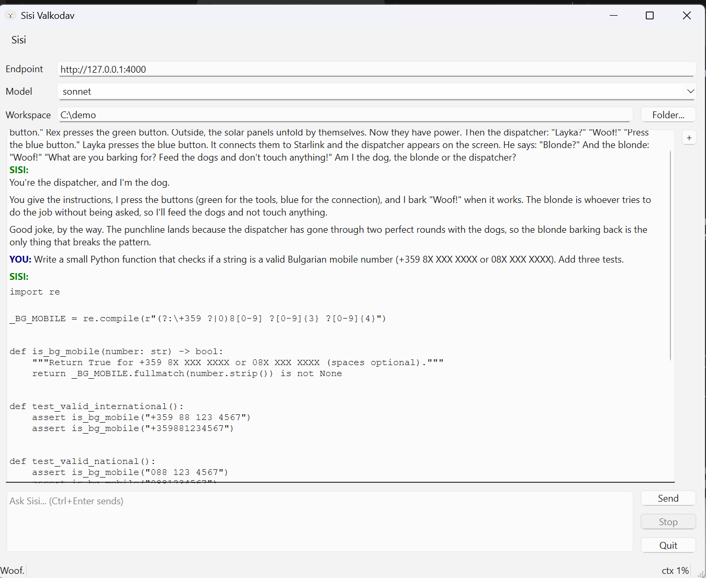

English

# Sisi Valkodav

Sisi is a desktop front-end (Qt 6) for [rex](https://github.com/peterkokosharov/rex), a coding agent. Sisi
starts rex as a background Python process and talks to it with JSON lines; rex does the model calls and the
tools, Sisi shows the conversation. It is a rich chat without Electron: Markdown, images and Mermaid diagrams
in a native Qt window.

Sisi is named after a friend's little bolonka who once fought a big dog over a bone; "Valkodav" means
wolf-strangler, which is the joke. Sisi is one of the rex front-ends: Layka (terminal), Sisi (desktop, Qt)
and Lassie (web, planned). All use the same rex.

## Screenshots

Main window: Sisi answers the joke about a rocket, two dogs and a blonde.



What the picture shows is listed in `docs/screenshots/README.md`.

## Install

Sisi needs rex and Python 3.12 or newer. Sisi does not bundle rex or Python.

**Windows.** Unzip `sisi-windows-x64.zip` anywhere and run `sisi.exe`. The Microsoft Visual C++ runtime DLLs
are included. If it does not start, run `vc_redist.x64.exe` from the zip if it is there, otherwise install the
Microsoft Visual C++ Redistributable (x64). For a desktop shortcut: right-click `sisi.exe` > Send to > Desktop
(create shortcut).

**Linux.** Unpack `sisi-linux-x86_64.tar.gz` and run `./sisi`. The Qt libraries are bundled; you need the usual
system X11/OpenGL libraries (for example `libxcb-cursor0`). The folder also has `sisi.desktop` and the icons
(`icons/hicolor`); `INSTALL-linux.txt` shows how to put them into your user menu.

**macOS.** Unzip `sisi-macos-arm64.zip`. The app is not signed: the first time, right-click `Sisi Valkodav.app`
> Open. Or remove the quarantine flag once: `xattr -dr com.apple.quarantine "Sisi Valkodav.app"`. Put
`sisi.ini` in `~/.config/sisi/`.

## Quick start

1. Get rex and start an endpoint. The simplest one is the claude-cli gateway from the rex repo:
   `python scripts/claude_cli_gateway.py` listens on `127.0.0.1:4000` and serves the model `haiku`. Any other
   OpenAI-compatible endpoint works too.
2. Put the rex checkout in a folder `rex` next to the program, or set `rex_dir` in `sisi.ini`.
3. Start Sisi. Defaults are `http://127.0.0.1:4000` and `haiku`. The Model list is read from
   `<endpoint>/v1/models`; you can also type a name. Pick a **Workspace** folder.
4. Type a prompt and press Ctrl+Enter or **Send**. **Stop** ends the current turn.

Sisi starts `<python> -m runtime --model <model> --jsonl --local-tools` with the workspace as working
directory. Changing endpoint, model or workspace restarts rex on the next Send; the conversation then starts
fresh. The menu Sisi > Reset conversation also starts a fresh context. The `+` button shows a second pane with
every tool call rex makes.

## Configuration

Copy `sisi.ini.example` to `sisi.ini` next to the program (Linux/macOS also `~/.config/sisi/sisi.ini`). The
keys are in the section `[sisi]`. Precedence: environment variable > `sisi.ini` > default.

| key | environment | default | meaning |
|---|---|---|---|
| `endpoint` | `SISI_ENDPOINT` | `http://127.0.0.1:4000` | OpenAI-compatible endpoint |
| `model` | `SISI_MODEL` | `haiku` | model name |
| `workspace` | `SISI_WORKSPACE` | current directory (home folder if started from Finder) | folder rex works in |
| `python` | `SISI_PYTHON` | `python` (Windows), `python3` (elsewhere) | interpreter that runs rex |
| `rex_dir` | `SISI_REX_DIR` | folder `rex` next to the program, if it exists | put in front of `PYTHONPATH` |
| `api_key` | `SISI_API_KEY` | `RUNTIME_LITELLM__API_KEY` from the environment, else `dummy` | only if the endpoint needs a key |
| `merman` | (none; see `MERMAN_HOME`) | `MERMAN_HOME`, else `PATH` | full path of `merman-cli` |
| `log` | `SISI_LOG` | no log | log file; keys, tokens, passwords and URL credentials are masked |

`SISI_CONFIG` is the path of the ini file itself.

## Permissions

When rex wants to run something it asks first. Sisi shows a modal dialog with the tool, its kind, a one-line
summary and the full detail (up to 20000 characters) in a read-only monospace box. A unified diff is coloured
(`+` green, `-` red, `@@` blue). Buttons: **Allow once**, **Allow always**, **Deny**. Deny is the default; Esc
and closing the window also deny. Several requests are shown one after another and each gets exactly one reply.
If rex exits, the turn ends or you press Stop while a dialog is open, it closes and the rest are denied.

## Context indicator

After every answer rex reports how full the model context is. Sisi shows `ctx P%` at the right of the status
bar, in orange from 80 % or when rex sets a warning; at a warning one line appears in the chat. The figure is
cleared on Reset conversation and when rex exits.

## Diagrams and images

Answers are shown as Markdown once they are finished (while streaming they are plain text). The chat is a
plain Qt text widget, no browser engine.

- A ```` ```mermaid ```` block is drawn as a picture if `merman-cli` is available
  (https://github.com/Latias94/merman, a single binary): put its folder in the environment variable
  `MERMAN_HOME`, or set `merman` in `sisi.ini`, or have it on `PATH`. Without it, or if rendering fails, the
  block stays as code and one line says why. Sisi does not ship merman.
- Images, ``, are shown inline **only from inside the workspace**. Relative paths
  start in the workspace; absolute paths, `..` that climbs out, links that lead out of the folder, `file://`,
  http(s) and `data:` are never loaded. Wide images are scaled to the window.

## Keyboard

- Ctrl+Enter in the prompt box sends (plain Enter adds a new line).
- Alt+S opens the Sisi menu (Reset conversation). Esc in the permission dialog denies.

## Build from source

Needs Qt 6.8 (Widgets, Network, Svg), CMake 3.16 and a C++17 compiler:

    cmake -S . -B build -DCMAKE_BUILD_TYPE=Release
    cmake --build build --config Release

Tests need no Qt and are a separate project:

    cmake -S tests -B build-tests
    cmake --build build-tests --config Release
    ctest --test-dir build-tests -C Release --output-on-failure

See `docs/ARCHITECTURE.md` for how the code is organised.

## Known limits

- One conversation at a time, one rex. Closing or restarting rex loses the conversation.
- The answer is plain text while it streams; Markdown appears when the turn ends.
- Diagrams need `merman-cli`; two render at the same time, each with a 15 s limit.
- The window is English only for now.
- The macOS and Windows builds are not signed.
- Quitting or restarting waits up to about 3 s for rex to end, so the window can pause briefly.

## AI authorship

Code here is largely written by AI models under the author's direction.

- Each source file's `AI models:` header line lists the models that wrote or edited it.
- Each AI-written commit carries a trailer `AI-Models: <ids>`.
- Unknown history is marked as such (`AI models: unknown (before 2026-11-24)`).
- `python -I tools/check_ai_header.py` fails if a file with an `Author:` header has no `AI models:` line.

## Licenses

Sisi is MIT (`LICENSE`). The INI parser `src/ini.c` and `src/ini.h` keeps its original Wine license
(Miguel de Icaza, 1993; `LICENSE-ini`). Qt 6 is used under the LGPLv3 and linked dynamically. merman is not bundled. See
`THIRD-PARTY.txt`.

Hobby project: made for fun, use it anywhere, no warranty.
