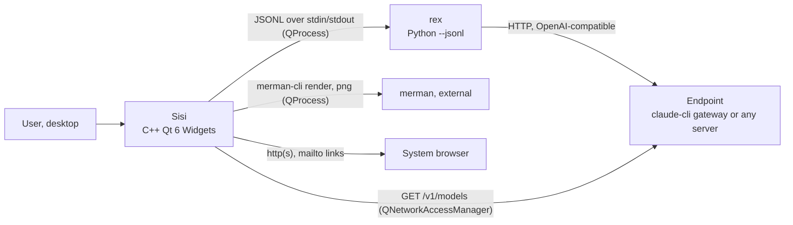

# Sisi architecture

For a developer who joins the project. It describes what the code does as of 2026-11-23.

## 1. What Sisi is

Sisi is a desktop (Qt 6 Widgets) front-end for **rex**, a coding-agent runtime written in Python. Sisi starts
rex as a child process and talks to it with JSON lines; rex does the model calls and the tools, Sisi shows the
conversation. Sisi is one of the rex front-ends: Layka (terminal), Sisi (desktop, Qt) and Lassie (web,
planned). All use the same rex. There is no Node, Electron or Docker in Sisi; the chat is a `QTextBrowser`,
not a browser engine.

## 2. Source files

| file | lines | responsibility |
|---|---|---|
| `src/main.cpp` | 20 | `QApplication`, name and icon, `loadConfig()`, shows `MainWindow` |
| `src/mainwindow.h` / `.cpp` | 88 / 415 | Window: settings fields, chat and bash panes, prompt, buttons, menu, status bar; Send/Stop/Reset, restart rule, models list, events from rex, permission queue, Ctrl+Enter filter |
| `src/rexbridge.h` / `.cpp` | 63 / 231 | `RexBridge`: starts and stops the rex `QProcess`, writes JSON lines, splits and handles the output |
| `src/chatview.h` / `.cpp` | 87 / 291 | `ChatView` (a `QTextBrowser`): entries, streaming, Markdown on final, images confined to the workspace, diagram hand-over |
| `src/diagram.h` / `.cpp` | 42 / 134 | `DiagramRenderer`: async merman jobs, 2-job queue |
| `src/permissiondialog.h` / `.cpp` | 27 / 95 | Modal dialog (Allow once / Allow always / Deny) with a diff highlighter |
| `src/config.h` / `.cpp` | 23 / 67 | Global `g_cfg`, `loadConfig()`, `logLine()` |
| `src/core.h` | 254 | Pure logic without Qt (testable): `Config`, `resolveConfig`, `parseModelIds`, `redactLog`, `PermissionQueue`, `PermissionReq`, `clipText`, diff classification, context label helpers |
| `src/markdown.h` | 113 | Pure helpers without Qt: `splitFences`, `isLocalImagePath`, `resolveImagePath` |
| `src/ini.c` / `ini.h` | 258 / 73 | INI file loader (from Wine), C |
| `tests/test_core.cpp` | 308 | Unit tests for `core.h`, `markdown.h` and `ini.c` |
| `resources/sisi.qrc`, `sisi.svg` | - / 41 | Qt resource file and the window icon |

Other files: `sisi.ini.example`, `CMakeLists.txt`, `tests/CMakeLists.txt`, `packaging/` (Linux packaging script,
icons, `.desktop`, Windows resource file), `.github/workflows/build.yml`, `THIRD-PARTY.txt`, `CHANGES.md`.

## 3. Runtime pieces

**Window (`MainWindow`).** Endpoint line edit, editable model combo box, workspace line edit with a Folder
button, the chat (`ChatView`), an optional bash pane (toggled by the `+` button; a `QPlainTextEdit` limited to
2000 lines that shows rex tool calls and rex stderr), a prompt box (80 px) and the buttons Send, Stop, Quit.
The only menu is Sisi > Reset conversation. The status bar shows `Woof.` or `Sisi is chewing...` and, at the
right, the context figure. `busy_` blocks a second Send while a turn runs. Ctrl+Enter in the prompt is caught
by an event filter on the prompt box. Closing the window cancels the permissions and stops rex.

**Restart rule.** `sendPrompt` compares endpoint, model and workspace with those of the running rex; if one
differs, or rex is not alive, it (re)starts rex and the conversation starts fresh (a status line says so). A
model-list request (`GET <endpoint>/v1/models`, 5 s timeout) runs at start; `parseModelIds` takes every
`"id": "..."` pair, a newer request aborts the older one, and what the user typed stays selected.

**rex bridge (`RexBridge`).** Starts `<python> -m runtime --model <m> --jsonl --local-tools` with a `QProcess`;
the working directory is the workspace, the environment is Sisi's own plus `RUNTIME_LITELLM__BASE_URL`, the
API key (config, else already in the environment, else `dummy`) and `rex_dir` in front of `PYTHONPATH`. The
channels are separate: stdout is JSON lines, stderr is noise (logged and shown in the bash pane).
`waitForStarted(5 s)` makes a bad python path fail at once. The reader keeps a buffer and hands out only
complete lines (a last line without newline at exit). Sisi sends `chat`, `reset`, `stop` and
`permission_reply`. Events handled in `handleLine`:

| event | effect |
|---|---|
| `token` | `token` signal: streamed text |
| `final` | `reply` then `turnDone` (the text only counts when nothing was streamed) |
| `tool_start` / `tool_end` | one line each in the bash pane (command, then done or failed) |
| `permission` | `permission` signal (id, tool, kind, summary, detail) |
| `context` | percent (or used and limit) and a warning flag |
| `error` | status line `[rex error]` and `turnDone` |
| `reset_ok` | status line `[context reset]` |
| `bye` | `turnDone` |
| not JSON | status line `[rex output]` (often a traceback) |

`ready` and `model_ok` need no reaction. **Stop:** Sisi sends `stop`, denies every waiting permission and
starts a 5 s timer; if rex has not ended the turn by then, rex is killed and restarts on the next Send.
**stop():** closes the stdin of rex, waits 1.5 s, then terminate (Windows: kill), waits again, then kill. The
GUI can block for about 3 s in the worst case; that keeps orphaned rex processes away.

**Chat view (`ChatView`).** Keeps a list of entries (user, Sisi, status; each with a `done` flag). While an
answer streams, tokens are appended as plain text. When the turn ends, `finishAnswers` marks the answers
done and `rebuild()` redraws everything: finished Sisi answers go through `prepareMarkdown` and
`QTextDocument::setMarkdown(..., MarkdownNoHTML)` in a scratch document that is copied into the chat, so raw
HTML in an answer is not interpreted. The scroll position is kept (it follows the end when it was at the end).
Status lines that arrive during streaming wait in `pendingNotes_` (`note()`) so they do not cut into the
answer. Links: `setOpenExternalLinks(true)` and `setOpenLinks(false)`; http(s) and mailto go to the system
browser, nothing else can replace the chat with a page.

**Images.** `rewriteImages` finds `` outside code fences (`splitFences`). Two checks: a lexical
one in `resolveImagePath` (no absolute path, no `file://`, no `..` out of the workspace) and a real-path one
in `insideWorkspace` (`canonicalFilePath` resolves symbolic links; case-insensitive on Windows). An allowed file
is read once and cached until its modification time or size changes, registered with `addResource` under a
private name `sisi://img/<sha1>`, and scaled to the pane width (a debounced rebuild runs 200 ms after a resize).
A file that is not an image leaves the Markdown as it is. The `loadResource` override returns a transparent
1x1 image for every image name the document does not know, so Qt never loads a file or URL by name on its own;
a blocked image stays invisible.

**Diagrams (`DiagramRenderer`).** `prepareMarkdown` finds fences with the language `mermaid`, hashes the body
(SHA-1) and looks in `diagramImages_`. Hit: the block becomes an image resource `sisi://diagram/<key>`. Miss:
the block stays code and `requestDiagram` asks once per key (`requested_`) for a render. `findMerman` looks in
`MERMAN_HOME`, then `merman` from the config, then `PATH`. Each job writes the source into its own
`QTemporaryDir`, starts `merman-cli render in.mmd -o out.png -f png -q` as a `QProcess`, and ends exactly once
(finished, failed to start or 15 s timeout, whichever comes first). At most 2 jobs run; the rest wait in a
queue. `done` is always emitted from the event loop (queued), also for immediate failures. On success
`ChatView` stores the image and rebuilds; on failure it says why once and the code block stays. The destructor
kills running jobs before the temporary folders go.

**Permissions.** `rex` sends `permission`; `MainWindow::onPermission` pushes the request into a
`PermissionQueue` (core.h), which refuses a missing or duplicate id. One `PermissionDialog` at a time is shown
(modal, `WA_DeleteOnClose`); when it finishes, `answerPermission` pops the id and sends `permission_reply` with
`allow_once`, `allow_always` or `deny`, then the next request is shown. Deny is the default button; Esc and the
window X reject. The detail is clipped to 20000 characters; a unified diff gets colours (`classifyDiffLine`).
`cancelPermissions` (turn end, Stop, rex exit, window close) closes the open dialog without a second answer and
denies all waiting requests.

**Context.** The `context` event gives `percent` (or `used` and `limit`) and a `warning` flag. The status bar
shows `ctx P%`, orange from 80 % or with the flag (`ctxIsHigh`); one chat line per warning. Cleared on reset and
when rex exits.

**Config and log.** `loadConfig` reads the ini from `SISI_CONFIG`, else `sisi.ini` next to the program, else
(Linux/macOS) `~/.config/sisi/sisi.ini`. `resolveConfig` (core.h) applies env > ini > default for each key and
builds a report for the log (the api key is shown as `***`). `logLine` appends to the log file when `log` is
set, and `redactLog` masks values after key/token/secret/password and URL credentials. Two defaults need Qt and
are set in `loadConfig`: workspace = current directory (the home folder when the .app starts from Finder with
`/`), rex_dir = folder `rex` next to the program if it exists.

## 4. CI and packaging

`.github/workflows/build.yml` runs on push to `main`, tags `v*`, pull requests and by hand. Job `tests` builds
and runs the Qt-free tests on Ubuntu, macOS and Windows. After it, three build jobs use Qt 6.8.3 from
`install-qt-action`: **linux** (`packaging/package-linux.sh`: the binary as `sisi.bin`, Qt libraries and plugins
next to it, a launcher `sisi` that sets `LD_LIBRARY_PATH` and `QT_PLUGIN_PATH`, icons and `sisi.desktop`; result
`sisi-linux-x86_64.tar.gz`), **macos** (`macdeployqt`, unsigned `.app`, zip) and **windows** (MSVC, `windeployqt`,
the MSVC runtime DLLs copied from the toolset folder, zip). A tag `v*` also creates a GitHub release with the
three files. The icon set (`packaging/icons`, `sisi.rc`, `.icns`) is wired in `CMakeLists.txt`. Tests are never
packaged. Qt is linked dynamically (LGPLv3); `THIRD-PARTY.txt` lists the licenses.

## 5. Tests

`tests/` is a separate CMake project (`cmake -S tests -B build-tests`) that compiles `test_core.cpp` with
`src/ini.c` only; it does not need Qt. That is why logic that can be tested lives in `core.h` and `markdown.h`
(no Qt, no UI): config precedence, model-id parsing, log redaction, the permission queue, diff and context
helpers, fence splitting and image-path rules. Not covered by automatic tests: `RexBridge`, `ChatView`,
`DiagramRenderer` and the dialog (checked by hand).

## 6. How to add a feature safely

1. Put the logic that needs no Qt into `core.h` or `markdown.h` and add tests to `tests/test_core.cpp` first.
2. A new rex event: add a branch in `RexBridge::handleLine` and a signal; connect it in `MainWindow`. Unknown
   events are ignored, so rex can add events without breaking Sisi.
3. A new config key: add a `cfgPick` line in `resolveConfig`, a field in `Config`, a row in `sisi.ini.example`
   and in the README table, and a test.
4. Anything that starts a process must end exactly once, be stopped in the destructor, and report through a
   queued signal (copy `DiagramRenderer`).
5. Anything that shows a file or URL from an answer must stay inside the workspace and go through
   `insideWorkspace`; never let Qt load a resource by name.
6. Draw answers through `ChatView::rebuild` and keep `MarkdownNoHTML`.
7. New source files go into `CMakeLists.txt`; run the tests and a real build before you commit.
8. Update the README and this file in the same commit.

Sources: the code in `src/`, `tests/`, `CMakeLists.txt`, `sisi.ini.example`, `packaging/` and
`.github/workflows/build.yml` of this repository (state of 2026-11-23); the structure follows Layka's
`docs/ARCHITECTURE.md`. Date: 2026-11-23.
